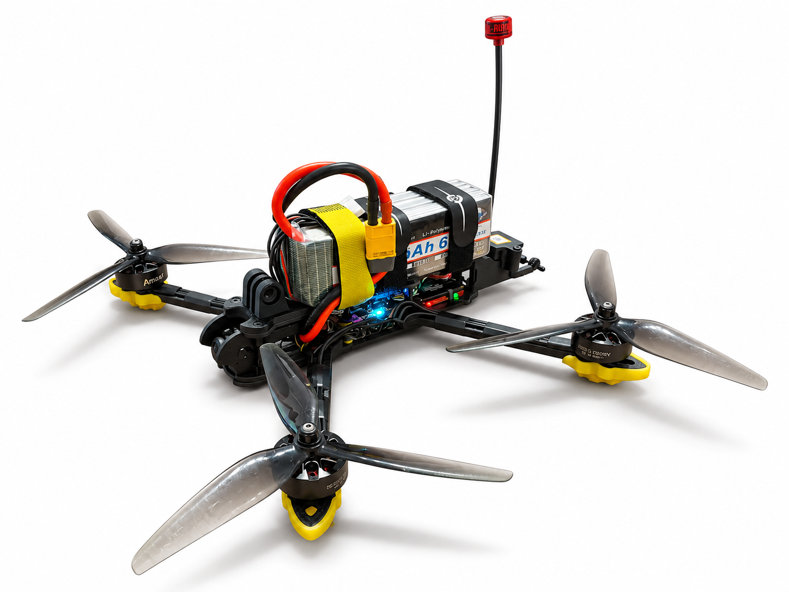
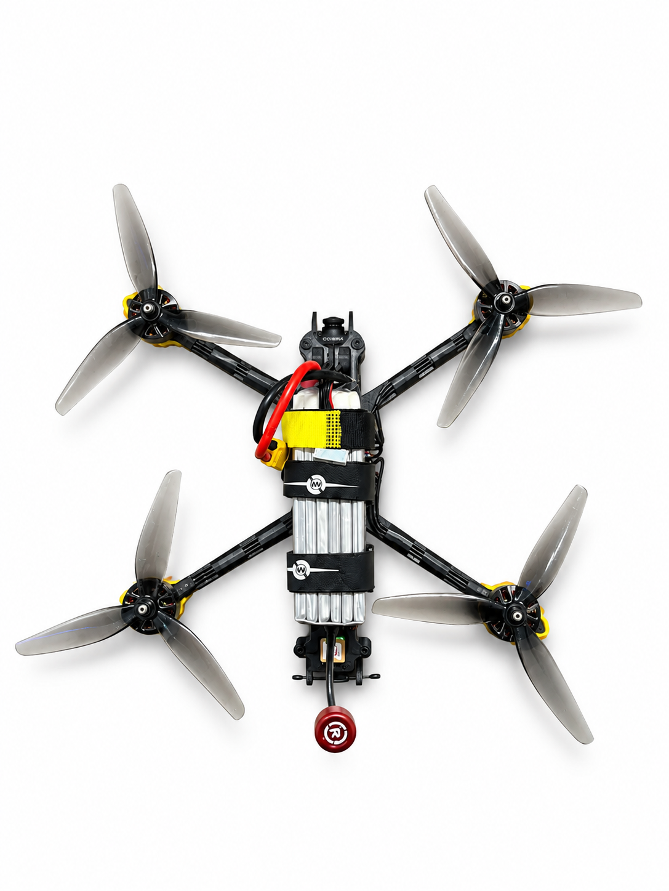
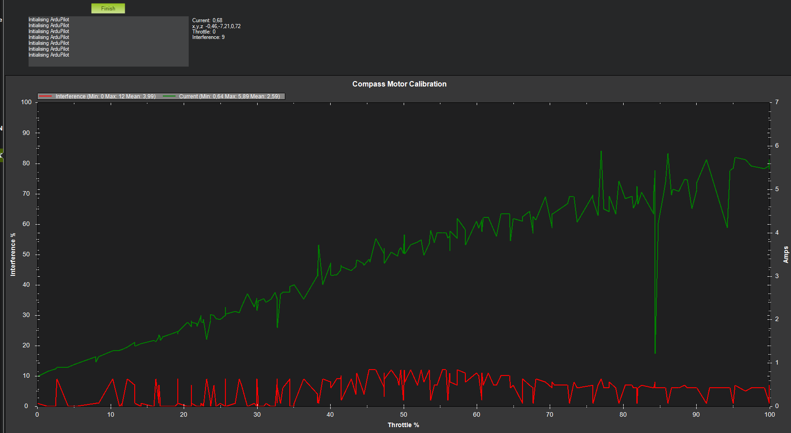

# 7-Inch FPV Quadcopter | ArduPilot Integration

**A hands-on UAV systems integration project — and an evolving platform for learning, testing, and iteration.**

<p align="center">
  
</p>

## Project Overview

This repository documents the ongoing development of my custom-built **7-inch FPV quadcopter**, integrating an **ArduPilot-based flight controller**, GPS navigation hardware, ExpressLRS radio control, and an analog FPV video system.

I started this project to move beyond a component-level understanding of drones and work directly with the practical challenges of **UAV assembly, avionics integration, mechanical packaging, and flight-controller configuration**. One of the most rewarding aspects so far has been turning real fit and integration constraints into small, tangible design improvements.

**The project is actively evolving.** This repository reflects the hardware assembled and the configuration work performed so far; it does **not** claim completed autonomous flight, demonstrated range, or flight-performance validation. As I carry out further tests, I plan to document the evidence and the lessons learned here.

## The Aircraft

<p align="center">
  
</p>

The platform is a **MARK7 7-inch quadcopter** with a **SpeedyBee F405 V4** flight controller, a **SpeedyBee BLS 60A 4-in-1 ESC**, a **Matek SAM-M10Q GPS**, and a **6S 3300 mAh LiPo battery**.

A complete, editable component inventory is available in the [Bill of Materials (Excel)](Hardware/FPV_Quadcopter_BOM.xlsx). It separates **onboard components** from **ground equipment** (RadioMaster Pocket ELRS and 008D FPV goggles) and software. The BOM is maintained as the hardware inventory; specific brands/models can be refined as needed.

## Mechanical Integration & Custom Mounts

Two practical changes were made to improve component placement on the airframe:

### GoPro mount — battery clearance

I adapted the existing GoPro mounting geometry to **shift its attachment point forward**, creating more room for the battery on the central frame. This is a packaging improvement based on the physical constraints of the assembled aircraft, rather than a claim of aerodynamic or flight-performance optimization.

### GPS mount — adapted geometry

I **combined and adapted existing model elements** to create a mounting solution for the GPS module. The work illustrates the iterative process of integrating navigation hardware into a compact airframe.

The underlying models were based on third-party designs. Because their redistribution conditions differ, **the source `.3mf` projects are not included in this public repository**. See [Mechanical Integration Notes](Mechanical-Integration/README.md) for details.

## Flight Controller & ArduPilot Configuration

The aircraft is configured using **ArduCopter 4.7.2** on the SpeedyBee F405 V4 flight controller. Integration and setup work to date includes:

- Quad-X airframe configuration and motor/ESC integration
- ExpressLRS receiver integration and radio configuration
- GPS and compass setup
- EKF3 configuration
- Battery-monitoring and failsafe parameter setup
- Mission Planner-based setup and troubleshooting

The actual exported parameter set is available at [`ArduPilot/mark4_7_inch.param`](ArduPilot/mark4_7_inch.param).

> **Configuration snapshot, not a flight-ready template.** These parameters reflect a specific hardware build and development stage. Calibration, failsafe behavior, control directions, and all other preflight checks must be verified on the actual aircraft before operation. Configured functionality should not be interpreted as flight-tested functionality.

## Testing & Evidence

### CompassMot — Motor-Induced Magnetic Interference

As part of the GPS/compass integration work, I carried out an **ArduPilot CompassMot ground test** to assess magnetic interference associated with motor operation at the selected compass mounting location. The recorded test provides an initial, quantitative check of the integration rather than a claim that the location is optimal.

<p align="center">
  
</p>

| Recorded metric | Result |
|---|---:|
| Mean compass interference | **3.99%** |
| Maximum compass interference | **12%** |
| Minimum compass interference | 0% |
| Mean reported current | 2.59 A |
| Maximum reported current | 5.89 A |

The measured interference remained relatively low over the recorded throttle sweep, with a **12% peak**. This is encouraging evidence that the selected compass placement is not experiencing severe motor-related magnetic interference **under these test conditions**.

**Limitations:** CompassMot assesses magnetic interference affecting the compass, **not GPS satellite reception or positioning accuracy**. Only the selected mounting position was evaluated; this result does not establish an optimal location. The reported current values have not been independently validated here, and a bench test cannot replace checks under representative flight loads.

## Current Status & Next Steps

**Current stage:** assembled UAV, integrated electronics and radio/video hardware, custom mechanical adaptations, and an exported ArduPilot configuration.

**Next development milestones (not yet claimed as completed):** expand ground-test documentation and GPS/compass assessment; collect and interpret flight logs following safe initial flights; progressively explore navigation and autonomous mission capabilities.

This is what makes the project exciting to me: **every iteration turns a design assumption into something that can be built, measured, challenged, and improved.**

## Repository Contents

```text
ArduPilot-FPV-Quadcopter/
├── README.md
├── Images/
│   ├── drone-top.png
│   ├── drone-diagonal.png
│   └── compass-motor-calibration.png
├── Hardware/
│   └── FPV_Quadcopter_BOM.xlsx
├── ArduPilot/
│   └── mark4_7_inch.param
└── Mechanical-Integration/
    └── README.md
```

---

*Personal engineering project. Ongoing development; documentation will be updated as further tests and iterations are completed.*
